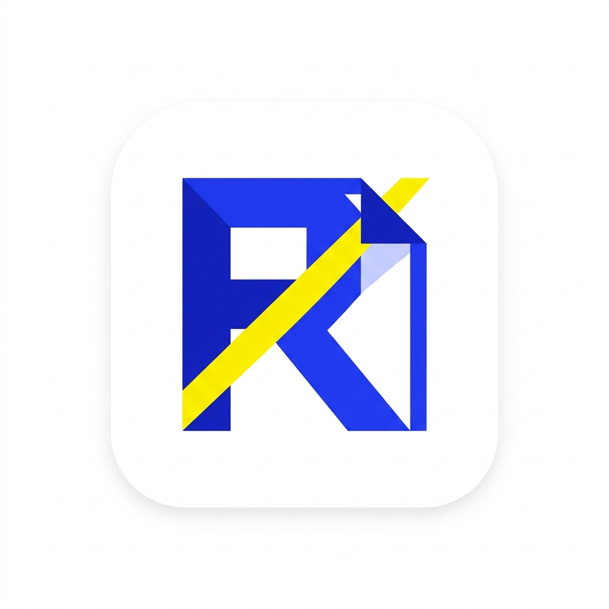
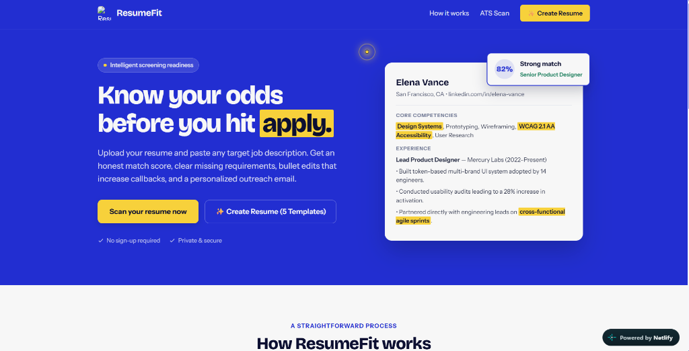
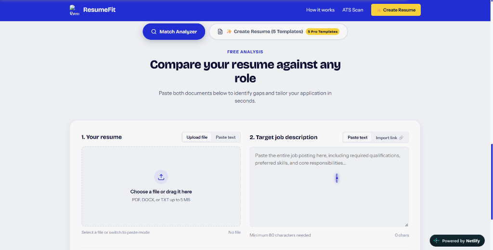
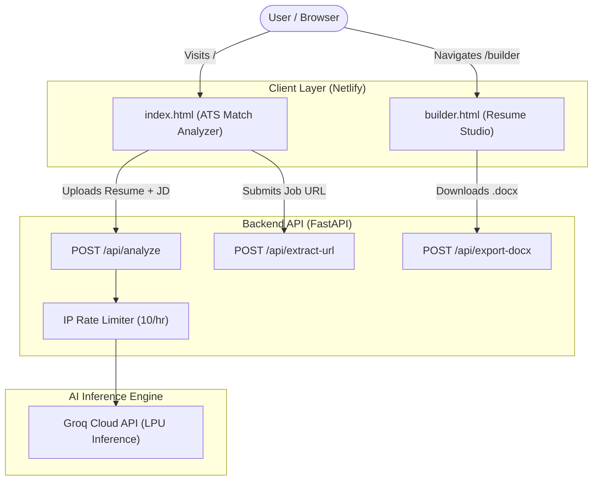

<div align="center">

  

  # ResumeFit

  ### Intelligent ATS Match Analyzer & Pro Resume Builder Studio

  [](https://super-rugelach-167614.netlify.app/)
  [](https://fastapi.tiangolo.com/)
  [](https://groq.com/)
  [](https://python.org)
  [](LICENSE)

  <p align="center">
    <strong>Know your odds before you hit apply.</strong><br>
    Compare your resume against any job description for an honest match score, keyword gap detection, bullet revisions, and tailored outreach notes — or craft an ATS-proof resume with 5 battle-tested templates.
  </p>

  [Explore Live App](https://super-rugelach-167614.netlify.app/) • [ATS Match Analyzer](#-core-features) • [5 Pro Templates](#-5-ats-tested-resume-templates) • [Getting Started](#-getting-started) • [API Docs](#-api-endpoints)

</div>

---

## 📸 Product Showcase

### 1. Interactive Landing & Readiness Overview
<div align="center">
  
</div>

<br>

### 2. Dual-Engine ATS Match Analyzer
<div align="center">
  
</div>

---

## ✨ Key Features

### 🎯 1. ATS Match Analyzer
- **0–100 Relevance Scoring**: Instant algorithmic & semantic comparison of your resume against any target role.
- **Skill Gap & Keyword Detection**: Identifies essential hard skills, tooling, and certifications present in the JD but absent from your resume.
- **High-Impact Bullet Rewrites**: Offers specific, metric-driven before-and-after improvements tailored to the company's technical requirements.
- **Recruiter Outreach & Cover Letter**: Generates a punchy, 160-word LinkedIn/cold email draft and a 3-paragraph tailored cover letter.
- **Multi-Format Ingestion**: Supports `.pdf`, `.docx`, plain text files, or direct text paste with drag-and-drop ergonomics.
- **URL Job Scraper**: Automatically extracts job posting text and requirements directly from job board URLs.

### 🛠️ 2. Standalone Resume Studio (`/builder`)
- **Dedicated Full-Page Workspace**: Responsive split-layout studio with input controls on the left and live 1:1 A4 canvas on the right.
- **Canvas Zoom Controls**: Seamless zoom in (`+`), zoom out (`−`), reset (`100%`), and auto-scale (`Fit`) modes.
- **Dynamic Field Management**: Add/reorder/remove experience items, education degrees, custom sections, and project entries on the fly.
- **One-Click Quick Skills**: Instant categorized skill chips (Frontend, Backend, DevOps, Data) to enrich your profile with a single tap.
- **Dual Export Channels**:
  - 📄 **Clean PDF Export**: Formatted `@media print` layout that prints exact 1-page A4 documents without URL headers or cut-off margins.
  - 📝 **Native Word (`.docx`) Export**: Generates authentic, ATS-compliant Microsoft Word documents using server-side OpenXML styling.

---

## 📑 5 ATS-Tested Resume Templates

Every template is deliberately engineered to pass Applicant Tracking Systems (Workday, Greenhouse, Lever, Taleo) without parse drops or encoding corruptions:

| # | Template | Origin & Signal | Best Suited For | Layout Style |
|---|----------|-----------------|-----------------|--------------|
| **01** | **Jake's Resume** | 50,000+ Overleaf forks | Software Engineers, New Grads | Clean single-column, horizontal dividers, high scan speed |
| **02** | **The McDowell CV / Apex** | Cracking the Coding Interview | FAANG / Top Tier SDE roles | High-density, project-first, metric-heavy bullets |
| **03** | **ASG ATS Resume** | Minimalist LaTeX standard | Systems, DevOps & Backend Engineers | Distraction-free typographic hierarchy, monospace tags |
| **04** | **Universal Résumé** | Modern Web/Print Hybrid | Full-Stack, Product & Mobile Devs | Prominent core competency grid, clean date alignment |
| **05** | **BelResumé** | European & International Standard | Global Tech & Enterprise Engineering | Structured timeline, bilingual-ready, corporate polish |

---

## 🏗️ Architecture & Technology Stack



- **Frontend**: Vanilla HTML5, Modern CSS (Glassmorphism, CSS Custom Properties, `@media print`), Vanilla ES6+ JavaScript.
- **Backend API**: FastAPI (Python 3.10+), Uvicorn ASGI server.
- **Document Processing**: `pypdf`, `python-docx`, `beautifulsoup4`, `httpx`.
- **AI Acceleration**: Groq SDK (`openai/gpt-oss-120b` or `llama-3.3-70b-versatile`).
- **Deployment**: Netlify (Frontend & Client Routing) + Render / Railway / VM (FastAPI Backend).

---

## 🚀 Getting Started

### Prerequisites
- Python 3.10 or higher
- A free [Groq Cloud API Key](https://console.groq.com/keys)

### 1. Clone the Repository
```bash
git clone https://github.com/megha250903/ResumeFit.git
cd ResumeFit
```

### 2. Set Up Virtual Environment

**Windows (PowerShell):**
```powershell
python -m venv venv
.\venv\Scripts\Activate.ps1
pip install -r requirements.txt
```

**macOS / Linux:**
```bash
python3 -m venv venv
source venv/bin/activate
pip install -r requirements.txt
```

### 3. Configure Environment Variables
Create a `.env` file in the project root:
```env
GROQ_API_KEY=gsk_your_actual_groq_api_key_here
MODEL=openai/gpt-oss-120b
PORT=8000
```

### 4. Run Locally
```bash
uvicorn app:app --reload --port 8000
```
Open your browser at:
- **Landing & Match Analyzer**: `http://localhost:8000/`
- **Resume Studio**: `http://localhost:8000/builder`
- **Interactive Swagger Docs**: `http://localhost:8000/docs`

---

## 🌐 Netlify Deployment (Frontend)

The frontend is fully configured for zero-config Netlify hosting with client-side clean URLs:

1. Connect your repository to **Netlify**.
2. Set **Publish directory** to `static`.
3. The included `netlify.toml` and `static/_redirects` automatically configure:
   - `/builder` ➔ serves `static/builder.html`
   - `/static/*` ➔ rewrites to root static assets
   - `/*` ➔ fallback to `index.html`

---

## 🔌 API Endpoints

| Method | Endpoint | Description | Request Payload |
|--------|----------|-------------|-----------------|
| `POST` | `/api/analyze` | Compares resume with job description | `multipart/form-data`: `resume_file` or `resume_text` + `job_description` |
| `POST` | `/api/extract-url` | Scrapes job posting text from an active URL | `{"url": "https://company.com/job/123"}` |
| `POST` | `/api/export-docx` | Generates formatted Microsoft Word resume | JSON payload with candidate info, template choice, experience, and skills |
| `GET` | `/builder` | Returns the Standalone Resume Studio page | N/A |
| `GET` | `/docs` | OpenAPI / Swagger interactive API documentation | N/A |

---

## 🔒 Privacy & Security

- **Zero Data Retention**: Uploaded resumes and job descriptions are processed in memory and never persisted to databases or third-party storage.
- **Client Key Isolation**: Groq API keys reside strictly on the server-side; client code never has access to inference credentials.
- **Built-in Rate Limiting**: In-memory IP protection (10 analyses per hour) prevents API abuse.

---

## 📄 License

This project is licensed under the [MIT License](LICENSE) — free for personal and commercial use.

<div align="center">
  <sub>Built with ❤️ for ambitious engineers seeking their next career breakthrough.</sub>
</div>
